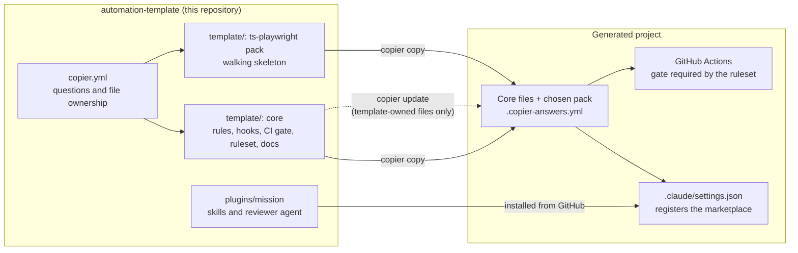

# automation-template

[](https://github.com/brunoccalmeida/automation-template/actions/workflows/ci.yml)
[](https://scorecard.dev/viewer/?uri=github.com/brunoccalmeida/automation-template)

A [Copier](https://copier.readthedocs.io/) template for test automation projects: an AI-assisted delivery harness (rules, skills, reviewer agent, CI gates) shared by every project, plus one pack per test stack.

It is extracted from two existing projects, [uat-automation-framework](https://github.com/brunoccalmeida/uat-automation-framework) (Python, Behave, Selenium) and [playwright-qa-starter-kit](https://github.com/brunoccalmeida/playwright-qa-starter-kit) (Playwright, TypeScript), which had grown the same harness by copy and paste. Each project now gets the harness from one place and takes its fixes with `copier update`.

## What a project gets

**The core**, the same in every project and free of any stack ([ADR 0003](docs/adr/0003-stack-agnostic-core-defines-contracts.md)):

- **Rules for the agent:** [`core.md`](template/.claude/rules/core.md) (test first, never change a test to make it pass, one mission per chat, wait for the result before acting) and a `CLAUDE.md` whose contracts table maps each role (`check`, `test`, `smoke`, `main-branch`, `gate`) to the project's real command ([ADR 0008](docs/adr/0008-core-rules-and-documents-in-the-generated-project.md), [ADR 0009](docs/adr/0009-contracts-as-copier-answers-and-a-shared-harness.md)).
- **Claude Code enforcement:** deny rules for `--admin`, force push and reading `.env`, a `SessionStart` hook that lists the open issues and pull requests, and the [`mission`](plugins/mission/README.md) plugin registered in the project's settings ([ADR 0010](docs/adr/0010-claude-code-enforcement-in-the-core.md)).
- **CI and GitHub:** a single gate job that needs every other job, a reusable workflow with a UTF-8 check, a secret scan (gitleaks) and a workflow audit (zizmor) ([ADR 0011](docs/adr/0011-ci-enforcement-as-a-reusable-core-workflow.md)), the ruleset that requires the gate, Dependabot for the actions, a Mission issue form and a pull request template ([ADR 0012](docs/adr/0012-github-files-rendered-by-the-core.md)), and a `/new-project` skill that applies the ruleset, labels, merge settings and Dependabot alerts and security updates ([ADR 0013](docs/adr/0013-new-project-applies-the-github-settings-with-a-shared-script.md)).
- **Documents:** the session summary, known issues, flaky test policy, and the ADR and spike report templates.

**A pack**, chosen by an answer, implements the contracts for one tool chain as a walking skeleton: infrastructure, documented folders and one smoke test, with no page objects or other domain code ([ADR 0002](docs/adr/0002-core-plus-packs-split-by-tool.md)).

| Pack | Status | What it adds |
| --- | --- | --- |
| `ts-playwright` | Available | Playwright and TypeScript with `e2e` and `api` as test types: an environment validated at startup, lint, type and format checks, an OSV vulnerability audit, the HTML report as a CI artifact and compact output for the agent ([ADR 0014](docs/adr/0014-ts-playwright-pack-walking-skeleton.md), [ADR 0015](docs/adr/0015-ts-playwright-pack-hardening.md)) |
| `python-behave-selenium` | Not yet available | Paused: it has a single source project, and the template takes in only what more than one source proves ([ADR 0006](docs/adr/0006-resume-copier-for-the-core-and-the-ts-pack.md), [#8](https://github.com/brunoccalmeida/automation-template/issues/8)) |

The answer `none` renders the core alone, with no pack: the contracts table reads "Not set" until the project fills it in.

## Architecture



The template is tested by generating projects: CI renders the core with every answer and checks the result ([`tests/test_template.py`](tests/test_template.py)), and generates a `ts-playwright` project and runs its own `check`, `test` and `smoke` ([`tests/packs/`](tests/packs/test_ts_playwright.py), [ADR 0007](docs/adr/0007-test-the-template-by-generating-the-core.md)).

## Create a project

You need Python 3.10 or newer, Git 2.27 or newer ([Copier installation](https://copier.readthedocs.io/en/stable/#installation)), the [GitHub CLI](https://cli.github.com/) and [Claude Code](https://code.claude.com/docs/en/overview); the `ts-playwright` pack also needs Node, the version in its `.node-version`.

1. Install Copier, at least the version the template is tested with (`_min_copier_version` in [`copier.yml`](copier.yml)):

   ```sh
   uv tool install copier==9.19.1    # or: pipx install copier==9.19.1
   ```

2. Generate the project. Copier takes the latest release tag of the template ([Generating a project](https://copier.readthedocs.io/en/stable/generating/)); add `--vcs-ref v1.0.0` to pin one. It asks for the project name, then the pack (the default, `none`, renders the core alone; choose `ts-playwright` for the pack), the test types and the contracts, which have defaults:

   ```sh
   copier copy gh:brunoccalmeida/automation-template my-project
   ```

3. Commit it and push it to a new GitHub repository:

   ```sh
   cd my-project
   git init
   git add -A
   git commit -m "chore: generate the project from automation-template"
   git branch -M main
   gh repo create my-project --public --source . --push
   ```

4. With the `ts-playwright` pack, tell CI which system to test, as an Actions variable:

   ```sh
   gh variable set BASE_URL --body https://your-system-under-test.example
   ```

5. Open Claude Code in the project and trust the folder: it offers the `brunoccalmeida-plugins` marketplace that `.claude/settings.json` declares, with the `mission` plugin. Then run `/new-project`, which applies the ruleset, labels, merge settings and Dependabot alerts and security updates, and reads them back. Until it runs, `main` takes direct pushes and the gate is not required. Rulesets are documented for GitHub Team and Enterprise; on GitHub Free they were seen working on a public repository, not on a private one.

The project's own README has the commands of its pack. From here, each change is a mission: an issue, a branch, a pull request that merges only with the gate green.

## Update a project

When the template releases a new version, from the project's root, with a clean working tree:

```sh
copier update
```

Copier reads the answers and the version in `.copier-answers.yml`, moves to the latest tag and applies the template's changes while keeping the project's; where it cannot tell which to keep, it writes conflict markers into the file, as `git merge` does, for you to resolve ([Updating a project](https://copier.readthedocs.io/en/stable/updating/)). The files the project fills in (README, `CLAUDE.md`, the session summary, `ci.yml`, `dependabot.yml` and the pack's skeleton files) are rendered once and never overwritten (`_skip_if_exists` in [`copier.yml`](copier.yml)); to change anything else, add a file of your own instead of editing the template's. Review the diff, run the project's checks and commit it as one change. Never edit `.copier-answers.yml` by hand.

## Claude Code plugin

The repository is also a Claude Code plugin marketplace, `brunoccalmeida-plugins`. Its [`mission`](plugins/mission/README.md) plugin carries the shared skills and reviewer agent: `/mission:close-mission`, `/mission:ship-pr` and `mission:reviewer`. A generated project registers it already; a project not generated from the template can install it alone, from its root, then commit `.claude/settings.json`:

```sh
claude plugin marketplace add brunoccalmeida/automation-template --scope project
claude plugin install mission@brunoccalmeida-plugins --scope project
```

The plugin names contracts (`check`, `test`, `main-branch`, …) instead of commands, so each project declares the real values in a table in its rules. The [plugin README](plugins/mission/README.md) describes that table, the repository settings the skills rely on, and how to update.

This repository runs its own missions with the plugin, installed from GitHub exactly as an adopting project installs it, with its contract table in [`CLAUDE.md`](CLAUDE.md#contracts), the shared core rules in [`.claude/rules/core.md`](.claude/rules/core.md), its review checks in [REVIEW.md](REVIEW.md) and a `ci-passed` gate required by the main ruleset ([`.github/rulesets/`](.github/rulesets/)).

## Design

- [Architecture Decision Records](docs/adr/): every decision that is expensive to reverse, with its context, alternatives and consequences.
- [Inventory](docs/INVENTORY.md): every piece of the two source projects, classified as core, pack or application-specific, with the better of the two implementations.

## License

MIT, see [LICENSE](LICENSE).
